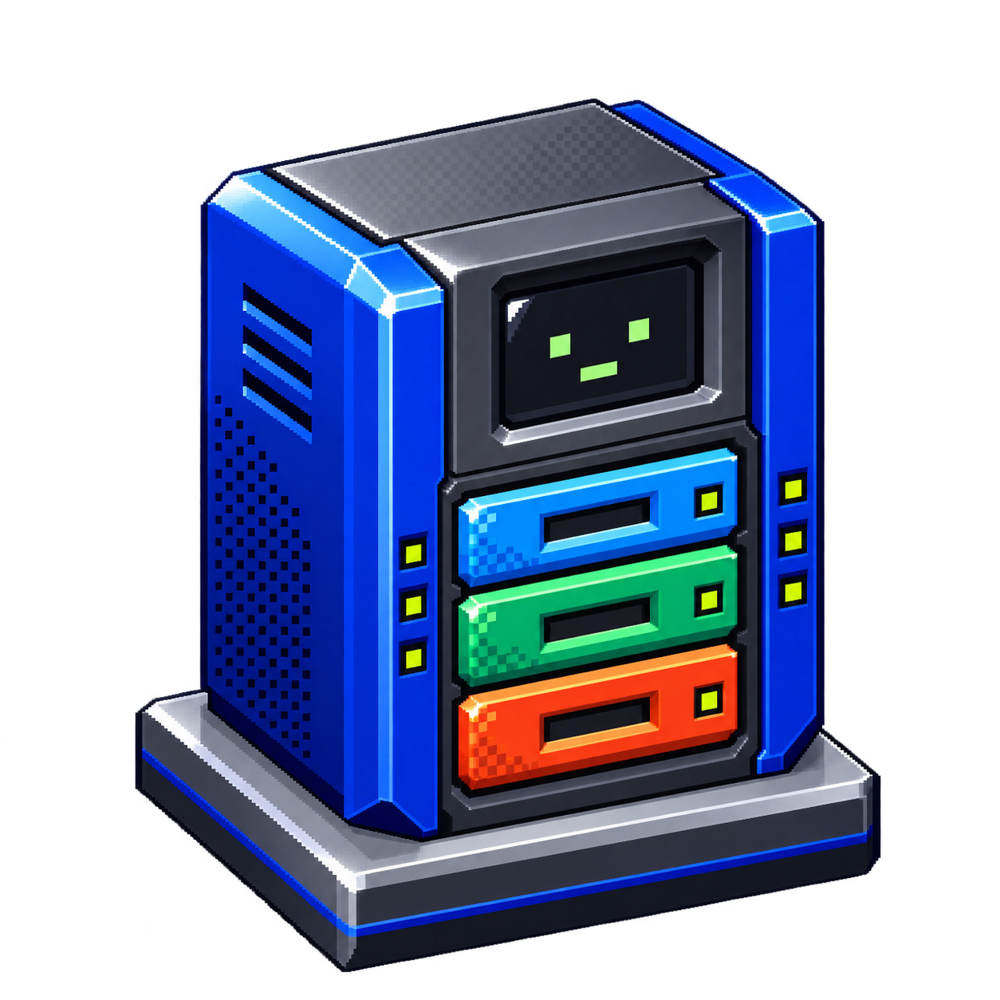
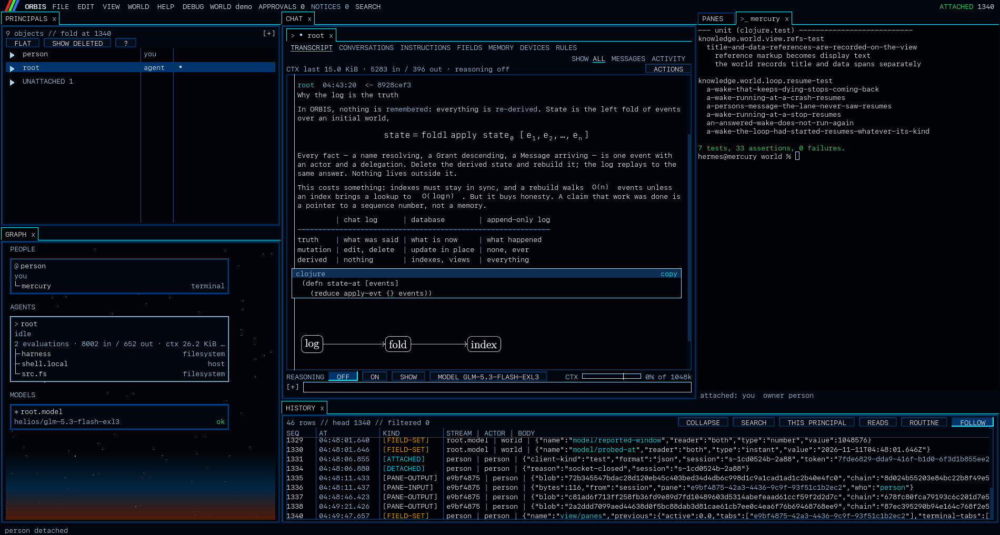
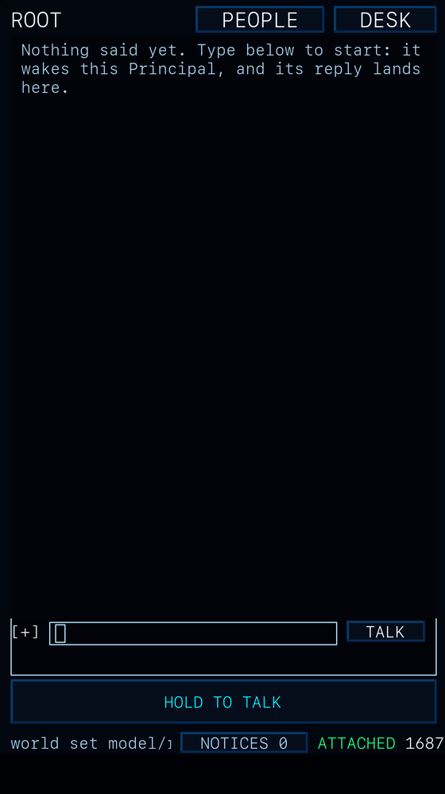
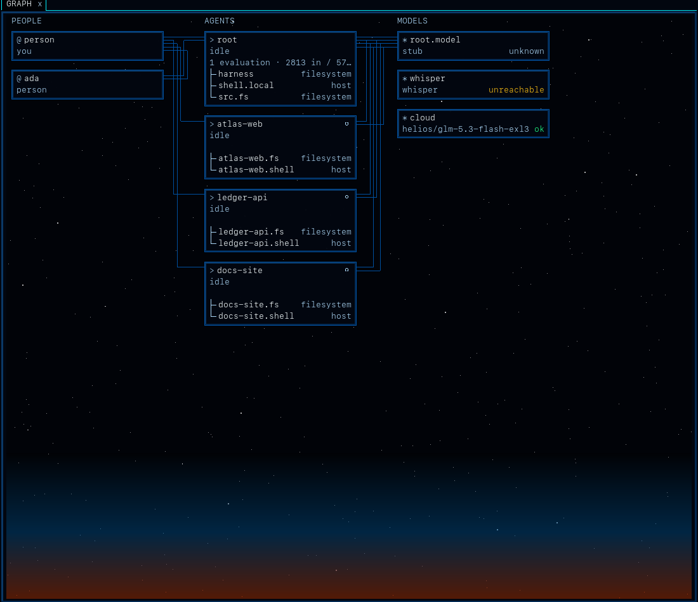
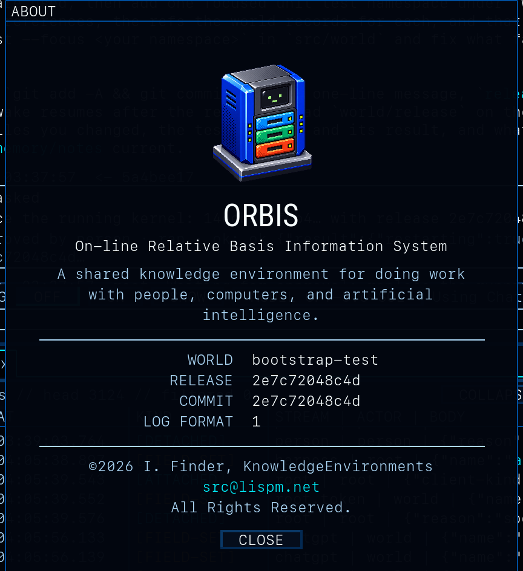
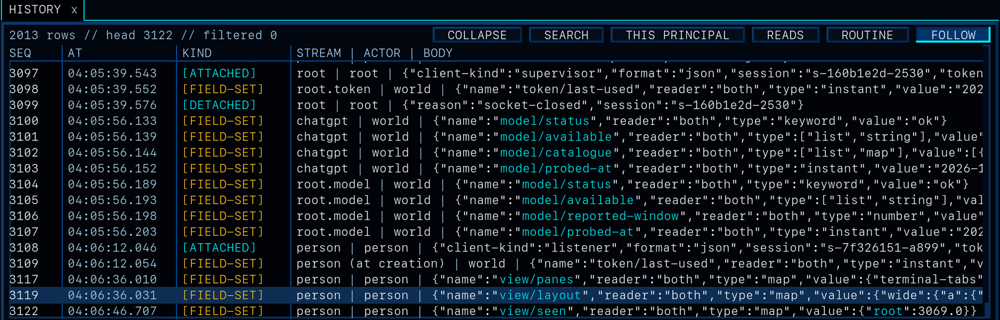
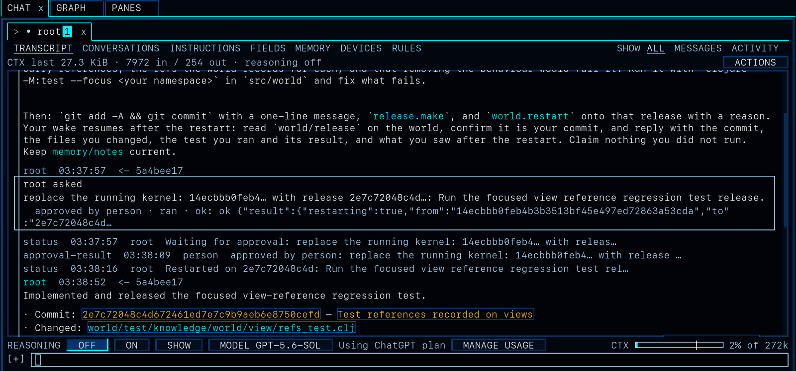

<p align="center">
  
</p>

<h1 align="center">ORBIS</h1>

<p align="center"><b>A shared knowledge environment for doing work with people, computers, and artificial intelligence.</b></p>

<p align="center">
<b>A scratch-built agentic system around a lost idea: the stateful, relational world.</b><br>
People, agents, models, machines and the work itself live in one persistent image with one record and one set of rules about who may do what.<br>
Not a chat window with tools stapled on. A place.
</p>

ORBIS is the On-line Relative Basis Information System. It is source-available, free for
noncommercial use; see [License](#license). It is brand-new alpha software: see [Known limits](#known-limits) before you run it.



*One window on one world: a chat with root (Markdown, typeset math, a table, code, a TikZ diagram rendered by the world), the GRAPH of people, agents and Models, a terminal that lives in the world and survives a restart, and HISTORY, the log itself, following the head.*

## What this is

ORBIS is an operating system for work done by people and AI agents together, built the way the great interactive systems were built and the industry forgot: one persistent, self-describing world with a cogent data model, instead of a pile of files and a chat window.

Forty years ago we had systems you lived inside. The Lisp machines and Smalltalk kept a whole world in one image, every object named, documented from within, inspectable at any depth; the expert systems knew that knowledge wants structure. Apollo's Domain/AEGIS made every object on every machine a name in one distributed, single-level namespace, a decade before the idea was reinvented and credited elsewhere. The MOOs put many people and programmable objects in one persistent room. Engelbart and Xanadu wanted every reference to be real. They lost to Unix and files, because their richness had a price paid in human attention, and people will not pay it. The lazy system won, and [worse was better](https://www.dreamsongs.com/WorseIsBetter.html).

The lineage is older than the web and less fashionable. The midrange machine whose operating system *was* the database: a single-level store, every object with its own authority, nothing outside it. The groupware whose unit was a document of typed fields with an access list, replicated between offices and worked on by agents, before the word was borrowed for something lesser. The expert systems, which knew that knowledge wants structure and that an inference should show its work. The Lisp machines and Smalltalk, where you lived inside the system and it could explain itself. Each got one thing right and paid for it in human ceremony.

An agent will pay that ceremony. It will name everything, keep the grants current, write the setup notes, mount the namespaces, and the product of all that ceremony is exactly what it needs to think: its own context. So the richness is affordable now. And the thesis runs further than affordable: the richness is what makes agents *cheaper* as a project grows and runs for months. A harness that stuffs a transcript gets worse with every week of history; a world that names things gets better, because the next wake reads the few objects that resolve for it and nothing else. Scope is attention. A marketing agent sees the brief and the positioning; the product agent sees the positioning and the plan; the developer sees the plan and the code. Each pays for exactly its slice, each slice stays small while the whole keeps growing, and the Grant that drew the line is the same record that says who knew what. That is the bet, and it is the opposite of the industry's: **better is better** after all. Groupware, expert systems and the integrated machine, meeting agents; build the world, and let the residents keep it.

Agents fail for one reason: context. Every harness today assembles it by hand, with retrievers, templates, "memory" files, skill folders and summarizers, none of which the system itself can see or audit. ORBIS makes context a property of the world. What a Principal can name is what it can read; depth and salience shape the rest; a named serialization caches it and replays it. The same predicate that answers "may you?" answers "what do you see?" and "what did that cost?". Permission, attention, cost and audit are one mechanism, not four afterthoughts.

What the industry is shipping instead is a for-loop around a chat completion with a vector database stapled to the side. "Memory" is a markdown file the model forgets to read. "Skills" are prompt-stuffing with a folder structure. "Multi-agent" is three of the same loop passing strings. Observability is a dashboard bolted on after the fact, over a transcript nobody can replay. None of it has a notion of *who may do what*, so the answer is always "everything, and we hope." That is not a harness. That is a prayer with retries.

The interaction model is the same joke from the other side. The state of the art is an agent in a tmux pane over ssh, scraping its own terminal, reporting in walls of monospace while you alt-tab to find out whether it did the thing. That is not a way for a program to work with a person. In ORBIS an agent has the tools to delight you: it *presents* a view, a typeset page, a diagram, a table that is yours to click; it opens a pane on your screen and you watch the same terminal it watches; it hands you a card that says exactly what will run, where, and waits; it cites a path and the path opens at the line; it leaves a notice that reaches your phone; and everything it did is one click from the record that proves it. A resident with a presentation layer, not a process with a pipe.

And the UI is there for the person to *understand*, not to be impressed. The world owns structure; the client owns legibility, and inspection is understanding. The GRAPH shows who is here, on what model, with which mounts and shells. HISTORY is the log itself, every seq, filterable to one Principal or one kind, following the head. A thread shows every op an agent made and what each answered, with the file it read and the line it changed. The gauge under the chat shows how much of the window the next wake will spend, and on what. A card says, in one line a person can decide on, what will run, through which shell, in which directory. Nothing is hidden in a log file, and nothing needs a log file: the record is the interface.

It is built to scale in ways no other harness can, because the scaling is conceptual, not a bigger box. Context cost scales with what a Principal may name, not with how long the world has existed: a thousand projects in one world cost an agent nothing until it can resolve them. The log is segments and snapshots under one retention limit, so a world that has run for a year boots from where it stands, and subscriptions are cursors with a window, so a thousand clients cannot make the server buffer. Loops are one per Principal with no shared state, so Principals run beside each other. Clients are thin because the work is in the world, so a phone costs the same as a desk. And streams federate where images never could: worlds link to worlds, a Principal here speaks to a Principal there, a fork of a world is a world, and the same grammar holds across all of them.

ORBIS is the other thing:

- **The log is the truth.** No image holds the system; every object has a stream, present state is a fold over it, a run is a value with a name. Replay it and you get the same world. Streams federate; images never did, and the single image is what killed the ancestors.
- **Context is a property of the graph, not of a prompt template.** What a Principal can name bounds what it can read. Depth and salience shape the rest. A named serialization caches it and replays it. The rules that set permission set context cost, and both are auditable.
- **The world is the harness.** There is no agent program outside it. The loop that resolves, serializes, evaluates and acts is kernel code, one per Principal, with no state outside that Principal's Fields. Sessions are streams, tools are actions, subagents are Principals, channels are Routes, cron is a Trigger, memory is authored Fields. Everything a harness ever did is a named object with a record.
- **People, agents and appliances are one class.** One namespace model, one API; a flag says what drives each. The product a team builds is itself a Principal, so the team is observable: who touched what, under which Grant, from which inputs, at what cost.
- **Workflows are deterministic because they are data.** A Task is an object, a card is an object, a rule is an object, a restart is an object. Worlds link to worlds; a Principal in one speaks to a Principal in another through a Route, and the whole exchange is on both logs. Many worlds, many people, many runtimes, one grammar.
- **It ships itself.** A world carries the release it runs and a working copy its root may edit. Root builds, tests, cuts a release and restarts the world onto it, and the swap waits for a person's own card. A release that fails health comes back on its own.
- **The dial from self-modifying to locked down is yours.** Nothing in the design decides how free an agent is; a Grant and a rule do. The same world runs a root that rebuilds its own kernel every night under standing rules, and a root that may not change a line without a person's card for each; a project agent that runs any test on its own, and one that asks before every command. Permission is per Principal and per op, it never descends wider than the grantor's, the kernel swap is the one gate no rule and no unsafe mode can open, and every decision sits on the log beside what it allowed. Evolution is a setting with a record, not a property of the software.

And the table stakes, since a system is not a demo. Of course it has a UI: a native client that treats legibility as first-order work, because a correct world you cannot read has failed the person. Of course it has persistence: one append-only log as the only truth, every object a stream, state a fold, no image, no save. Of course it is multi-user: a person, a process and an appliance are one class with one namespace model, in the same room, on the same record. Of course it has inheritance: Grants descend and narrow, charters template, memory and instructions are authored Fields a Principal carries with it. Of course it is hypertext: every reference is a real, resolved, two-way span, and a made-up name cannot pass as a link. Of course it multiplexes: terminals, files, editors and typeset pages are Objects in the world that any client draws, including a phone with no shell of its own.

### The ontology, in one breath

An **Object** has named **Fields** and a stream of **Events**. A **Principal** is an Object that acts: driven by a person, by a process on a **Model**, or by nothing, an appliance. A **Grant** says what a Principal may do to which names, and `resolves?` is the one predicate that carries access, attention, cost and audit; a **Group** is a Grant's shorthand for several. A **Route** is where Principals speak; a **Message** is what they say, with its references as exact spans. An **Adapter** backs Objects that live elsewhere: a filesystem, a shell, a container, an API, another world. A **Serialization** is a named, cached slice of the graph: a prompt, a view, a page; an **Evaluation** is one Model call over one, with its ops and their results. A **Task** is work with a state machine, which is also how an approval is a card. A **Trigger** wakes a Principal on time or on an event. Fourteen classes, nine value types, sixteen event kinds, and nothing else. `docs/ontology.md` is generated from the schemas that enforce it.

The ideas are in `docs/ethos.md`, the wire in `docs/protocol.md`, who may do what in `docs/authority.md`. The same documents are built into a running world as its manual, because a world should explain itself.

## Features

What is in the tree today, as a list for the impatient:

- **World**: an append-only, CRC-checked log of Transit frames; a Datascript index folded from it; snapshots and retention under one disk limit; export, import, fork and promote; worlds that link to worlds.
- **Principals**: people, agents and appliances as one class; Grants that resolve per name and per op and never widen; Groups; Routes and Messages with real references; tokens per device, pairing by code or QR, revocation.
- **Agents**: the loop as kernel code, one per Principal; serialization bounded by what resolves, with a known window and a cost gauge; memory and instructions as authored Fields; triggers and heartbeats; cards for every command and rules that admit classes of them; a work log for long tasks; guards against claims with no run behind them.
- **Models**: any OpenAI-compatible chat endpoint; Sign in with ChatGPT for plan usage; a choice per Principal or per conversation with a fallback; reasoning on or off per wake; speech to text and text to speech through Models that have them.
- **Self-hosting**: a world carries the release it runs and a working copy root may edit; `release.make`, `world.restart` under a person's card, health check and automatic rollback, a supervisor that is one shell script; a bootstrap test that proves the loop on a real model.
- **Projects**: `add_project` from a path or a git URL makes a Principal, a mount, a shell and a narrow Grant in one op; commands run in a box (`sandbox-exec`, `bwrap`) with network and SSH through an agent; `git` and `ssh` never see a key.
- **Panes**: terminals, file managers, editors and viewers as Objects in the world; a terminal holder that keeps shells alive across a restart; TeX typeset in the world; Markdown with tables, code, math and diagrams; images in and out.
- **Client**: C++20, SDL3, Dear ImGui, FreeType; a tiled window of views and panes with a layout that is a Field of yours; the GRAPH, PRINCIPALS, CHAT, HISTORY and PANES views; search; notices and an approvals centre; a drive API that scripts the whole UI end to end for tests.
- **Phone**: the same client on iOS and Android; TOUCH and DESK modes; hold to talk; pairing by QR; a session that survives the background.
- **Tooling**: `scripts/install.sh` from a clean checkout to a running world; `start.sh` to bring it back and show how to connect; `make smoke` in two minutes, `make test` for a release; a scrubbed export that keeps the public tree clean.

## Hypertext, persistence, multiplexing

Byte streams on file descriptors were never going to be the future. Neither was `ssh` into a box with a text file that calls itself memory. The ancestors knew it: objects, streams, inheritance, persistence, state, a data model you could reason about, a system that could describe itself. ORBIS takes those three words seriously.

**Hypertext.** Every reference is real. A name in a Message, a view's title, a summary, written as `[[name]]`, resolves under the reader's Grants and is stored beside the text as exact spans (`message/refs`, `view/title/refs`); the display text stays plain, the reference stays a reference. A path a model cites is checked against its own working copies by the world and marked as a path. In the listener every one of them is a link to a Principal, a Field, a file at a line, a commit, and what a model wrote that resolves to nothing stays literal and is listed, so a made-up name can never pass as a link. Xanadu's two-way link, done by a kernel that knows who is asking.

**Persistence.** No image, no checkpoint, no "save". The log is the truth and it is never rewritten; Objects, indexes, views and memory are folds of it, thrown away and rebuilt at will. A client that drops reattaches with its session and the last seq it acknowledged and sees no gap, whether the world stayed up or restarted. A world survives its own kernel swap with the wake that asked for it still running. Snapshots stand in for pruned history under one retention limit; worlds are backed up, exported, imported, forked and promoted whole, because a world is a value.

**Multiplexing.** A pane is a live surface in the world, not in a client: a terminal on a shell, a file manager on a directory, an editor or viewer on a file, a typeset page of TeX. It is an Object with Fields like everything else, so closing a client leaves it running, several clients attach to one pane, and a person, a model and a remote client drive it through the same named actions. The terminal holder keeps terminals alive across a world restart. A person's layout is a Field of theirs, so the same panes open on the Mac and on the phone, and the phone, with no shell and no files of its own, sees exactly what the desk sees. Apollo put every object on the network into one namespace; here the namespace is the world, and the screen is one more thing in it.

**The window.** One window, tiled. Every view and every pane is a tile in a tree of splits and tabs: the graph beside the chat, a terminal beside the file it is editing, the log under all of it, a typeset page floated out while you read. Drag a tab to split, dock, float or tab it; the layout is a Field of yours, so it comes back on the next launch and on the next machine, and a phone gets the narrow arrangement of the same tree. Focus follows the mouse; a pane an agent opens for you appears beside the conversation that opened it. You never have to leave: the terminal, the editor, the viewer, the approvals, the notices and the record are all here, and nothing of yours is in another app's window. On a phone, TOUCH mode is one conversation and a bar to hold while you speak; DESK mode is the same tabs at thumb size.

## On the phone

The same client, built for iOS from the same tree (`listener/README.md`; Android in `listener/platform/android/`). It holds nothing the world does not, so a phone with no shell and no files of its own still sees every pane.



- **TOUCH mode**, the phone's default: one conversation, the line, and a bar across the bottom you hold while you speak. The words land in the line to read before you send; the world transcribes through any Model with speech-to-text (a local whisper will do). SPEAK beside the bar reads the last reply aloud through a Model with text-to-speech. Cards come to you at thumb size.
- **DESK mode**: the desktop's panes as tabs; `[ desk ]` and `[ touch ]` on the bottom line switch, and a foldable keeps a mode per screen.
- **Pairing by QR**: DEVICES on your own page shows a code and a QR; the phone's Camera opens the app with the world and code filled in; one tap claims a token for that phone alone, labelled and revocable from the desk.
- **Background and back**: closing the phone closes the socket without detaching; opening it reattaches with the session and the last seq it acknowledged, and sees no gap.
- Notices, approvals and the whole record are the same objects as on the desk, because they are the world's, not the client's.

<br clear="all">

## Pictures

| | |
|---|---|
|  |  |
| The GRAPH view: who is here, on what, with which mounts and shells. | A world says what it runs: release, commit, log format. |



The HISTORY view is the log itself: every seq, who did it, what changed. Filter to one Principal, to reads, to routine bookkeeping, or follow the head.

## Five minutes

```
scripts/install.sh
```

The installer checks the toolchain, offers Homebrew for what is missing, asks for a Model, builds the listener, makes a world in `data/`, starts it under its supervisor and opens the listener on your token. `docs/install.md` has every step by hand, a client-only install for a second machine, and what to do when something does not start.

Then, in the listener:

1. Click **root** in PRINCIPALS. Type in the box at the bottom. Root reads the harness it runs from, so ask it what it is.
2. **Add a project.** Tell root `Call add_project with name "myapp", path "/path/to/myapp"`. One op makes a Principal, a mount, a shell and a Grant narrower than root's; the new agent reads only there.
3. **Decide a card.** Ask the project's agent to run its tests. The command is a card in APPROVALS: what it will run, through which shell, in which directory. Approve it, or add a rule so test commands run on their own from now on.
4. **Change the Model.** The bar under the transcript: MODEL picks any Model in the world for this Principal or this conversation; REASONING turns thinking on; CTX shows how much of the window the next wake will use.

## Requirements

Developed and tested on Apple Silicon macOS only.

- World: OpenJDK 25 and the Clojure CLI.
- Listener: Xcode's clang, CMake 3.28 or later, Ninja. `sdl3` and `freetype` from Homebrew make the build quick; without them both are built from source.
- Holder: Zig 0.17.0, for terminals that survive a world restart and for `make test`. `make holder` clones and builds libghostty-vt.
- A model: any OpenAI-compatible chat endpoint, or a ChatGPT plan to sign in with from the listener.
- Optional: `tectonic` for TeX rendering.

```
brew install openjdk@25 clojure/tools/clojure cmake ninja sdl3 freetype zig
```

## Build and run by hand

```
make deps        # Clojure dependencies
make listener    # the client; fonts and libraries are fetched at configure
make holder      # the terminal holder
make test        # schema, unit, exit and kernel-zero tests; run after make holder
```

A supervised world, the kind root can change and restart: write `<dir>/world.env` (`docs/install.md`
shows it), then `scripts/world.sh <dir>`; `scripts/supervise.sh --stop <dir>` stops it. A plain world:
`cp .env.example .envrc`, set the model URL, id and key, `scripts/run-world.sh`. The first start
creates the data directory with `root.token` and `person.token`: treat those as passwords. A world
listens on `127.0.0.1` by default; `KE_BIND=0.0.0.0` opens it to the network, with no TLS, so only one you trust.

On macOS the JVM needs Local Network permission to reach a model on another machine, and that
permission belongs to the app that started it. If the world gets "No route to host" while `curl`
works, start it from Terminal.app: `open -a Terminal <dir>/start.sh`.

The listener: `./listener/build/macos-debug/listener --url ws://127.0.0.1:7777/ws --token-file data/person.token`.
On a second machine, copy the token once; a phone pairs by QR code. `KE_PUBLIC_URL` is the address
clients are told to dial.

## Before you run it

ORBIS runs agents that read and write files and run commands on the machine that hosts the world. Read this before you give it one.

- **Root's shell is yours.** Root is the operator: its commands run as the user who started the world, outside the box, so it can do what you can do there. Every other Principal's commands run in a confinement box (`sandbox-exec` on macOS, `bwrap` on Linux) that keeps them inside their mounts. The box has not been reviewed as a security boundary. Run a world under its own user account on a machine you can afford to rebuild.
- **The Model sees the prompt.** What you type to a Principal, and what it reads to answer, goes to that Principal's Model: your own endpoint on the LAN, or OpenAI if you signed in with ChatGPT. Never type a password or a key into a chat; a Message is on the log for good and in the next prompt.
- **Tokens are the only authentication, and there is no TLS.** `person.token` and `root.token` in the data directory are passwords; they are `0600`, keep them so. A world listens on `127.0.0.1` only unless `KE_BIND=0.0.0.0` says otherwise (`scripts/install.sh --lan`), and then in the clear: keep it on a network you trust, or behind a VPN, and set `KE_PUBLIC_URL` to the one address it should be dialled at.
- **Secrets stay out of the record.** Model keys are read from the environment variable `key-env` names, never stored as Fields; ChatGPT sign-in tokens live under `credentials/`, which the box denies. `.envrc` is git-ignored. The log is exported, forked and backed up whole, so treat the data directory as sensitive.
- **Cards are the control.** A new Principal starts with every command gated; a person decides each card or writes a rule for a class of commands. A new release of the kernel always waits for a person's own card, and nothing an agent writes can lift that. If a card surprises you, deny it and ask.

## ORBIS is self hosting



*Root, on a hosted model, has just changed ORBIS's own source, tested it, cut a release and asked to restart the world onto it. The person approved the card. The world came back on root's commit, root's wake carried on, and it reported with the commit, the files and the test it ran. Every line of that is on the log.*

### The demo, end to end

`scripts/test-bootstrap.py` runs the picture above end to end, with a script that plays the person. It makes a fresh world from the checkout's HEAD, puts root on a real model, gives it an open item from the work list, decides root's cards by a policy it prints, approves the kernel swap, and checks from outside: the world runs root's commit and it is good, the commit touches what the task named, tests ran before the release, the reply names the commit, the behaviour the task asked for holds on the new world.

```
scripts/test-bootstrap.py <scratch> --port 7811 --record <dir with a ChatGPT sign-in record> --task view-refs-test
```

What root wrote back on one run, verbatim:

> Implemented and released the focused view-reference regression test.
> - **Commit:** `2e7c72048c4d672461ed7e7c9b9aeb6e8750cefd` — `Test references recorded on views`
> - **Changed:** `world/test/knowledge/world/view/refs_test.clj`
> - **Test run:** `clojure -M:test --focus knowledge.world.view.refs-test` — 1 test, 8 assertions, 0 failures.
> - **Restart:** moved the running kernel from `14ecbbb0feb4…` to the release above.
> - **Post-restart confirmation:** `world/release` reports commit `2e7c72048c4d…`.

200 seconds wall, 150 of them the model's, one card. The test it wrote is on this branch. The report with both runs, including the defect the first run found in the kernel, is `the project's own notes`. The design for what comes next, a wake's own failures becoming a change, is `docs/lessons.md`.

## Talk to a world from anything

The protocol is JSON (or Transit) over a WebSocket: four frame kinds, a few dozen ops, every response carrying the log head. `docs/protocol.md` is the contract; `docs/protocol-examples/` has one file per frame. A person's session in ten lines, with the standard library only:

```python
import sys; sys.path.insert(0, "scripts/bench")
from ws import World                                 # scripts/bench/ws.py
w = World(token_file="data/person.token", port=7777) # attach as you
root = w.resolve("root")
route = w.resolve("root.route")
w.call("send", {"to": [root], "route": route, "text": "what is this world running?"})
for e in w.events(w.head() - 50):                    # the log, from 50 events back
    print(e["event/seq"], e["event/kind"], e.get("event/stream"))
```

The same ops the listener uses: `attach`, `read`, `set-field`, `send`, `history`, `act {action, args}`. `scripts/world-health.py`, the supervisor's health check, is the same client in forty lines.

## How it is built

**The stack.** The world is Clojure on the JVM: an append-only log of Transit frames with CRCs, a Datascript index folded from it, Malli schemas for every class and frame, http-kit serving the protocol as JSON or Transit over WebSocket, and the agent loop as kernel code; it drives any OpenAI-compatible model, or ChatGPT by sign-in. The listener is C++20 on SDL3 and Dear ImGui with FreeType text, Metal underneath on Apple platforms, one codebase for macOS, iOS and Android; it holds no state the world does not, and draws what the world sends. Terminals are kept alive across restarts by a small Zig holder on libghostty-vt. The supervisor is a bash script with nothing to install. TeX is typeset by tectonic inside the world's box.

```
schema/    Malli schemas shared by the world and generated for the listener
world/     the world: log, fold, index, resolution, serializer, loop, actions, protocol, adapters
listener/  the client: C++20, SDL3, Dear ImGui (docking), FreeType; desktop, iOS, Android
holder/    the terminal holder: terminals outlive a world restart (Zig, libghostty-vt)
scripts/   install, run, stop, release, supervise, back up, fork, export; the bootstrap test
docs/      the contract and the working documents
```

- The log is the truth: `docs/log-format.md`. The fold builds the index; a snapshot stands in for pruned history.
- Resolution decides who may do what: `docs/authority.md`.
- A world that carries and changes its own source: `docs/self-hosting.md`.
- Why things are as they are: `docs/decisions.md`, append-only. The ethos: `docs/ethos.md`. How an agent works on this repository: `AGENTS.md`.

## Known limits

ORBIS is alpha software, truly: weeks old, one author, used daily by that author and nobody else yet. It is an exploration, and a synthesis of ideas its author holds dear: a demonstrative alpha, not a proven thesis. Many of its ideas will change, some will evolve into something else, and some will turn out redundant once the agents have lived in it for a while; the record will show which. The loop closes and the record is real; the claims above are the bet, and what follows is where the bet is still open.

- Real work inside ORBIS holds on a strong hosted model (the demo above, on gpt-5.6-sol) and not yet on a small local one: agents can read, write and run in a box, but a local model writes against APIs it has not read.
- Expect to lose worlds. Upgrading one in place works through root's releases, and the log only moves forward, but the log format can still change.
- macOS on Apple Silicon is the only tested host. Linux and the phone builds get far less use.
- There is no TLS, and tokens are the only authentication. The confinement box limits an agent's mistakes. It has not been reviewed as a security boundary, so do not run untrusted models or prompts against a machine you care about.
- The holder's libghostty-vt is pre-1.0 and pinned to one commit.
- The design documents describe intent, and some are ahead of the code.

## Contributing

Pull requests are open: `CONTRIBUTING.md` has the terms (a contributor grant, so the author keeps the right to license ORBIS commercially) and what a change needs.

## License

PolyForm Noncommercial 1.0.0: use it, change it, share it for personal, research, educational,
nonprofit and government purposes, free. Commercial use needs a license from the author; ask.
It comes as is, without warranty, and nobody who wrote it is liable for what you do with it; the
license says so in full. See `LICENSE`. Third-party components keep their own licences: `THIRD_PARTY_NOTICES`.
